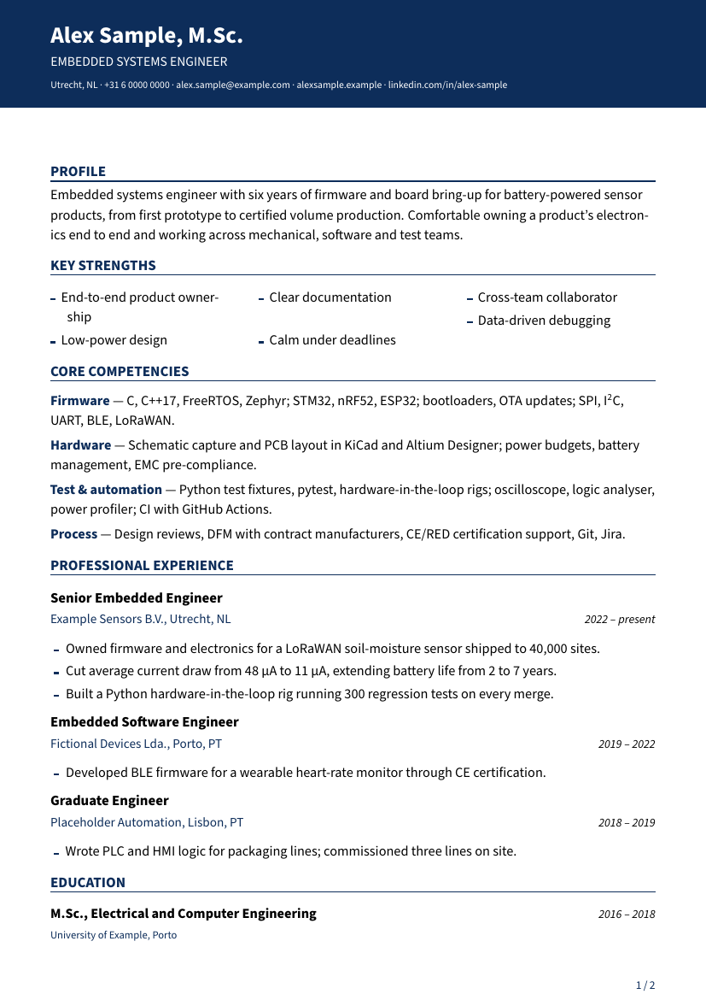
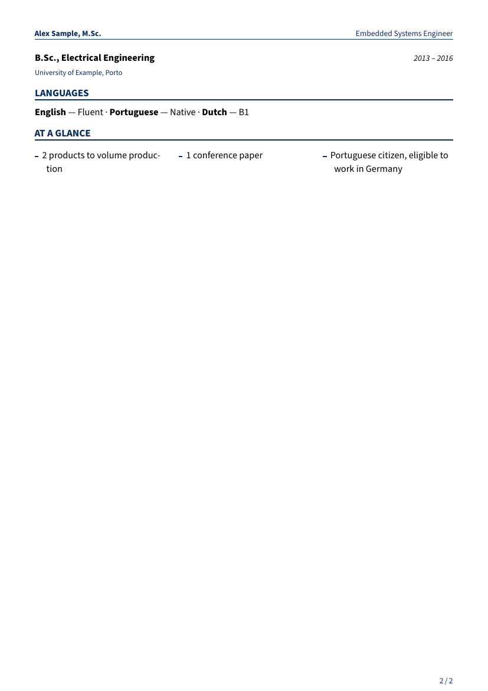
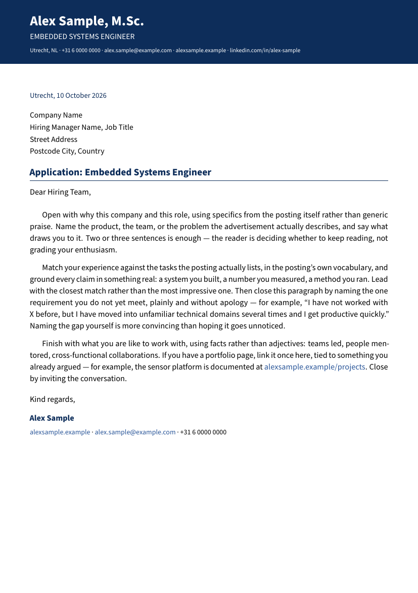
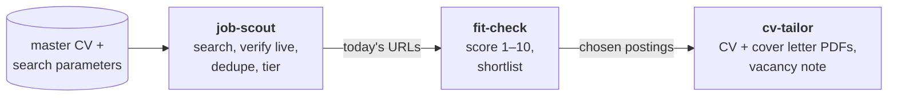

# Job Hunt Kit

A job-search pipeline for [Claude Code](https://code.claude.com). It finds live vacancies that
match your profile, scores each one against your CV, and writes a tailored two-page CV and
one-page cover letter for the ones worth applying to. The output is ATS-safe PDFs built from a
LaTeX template. One rule runs through all of it: **nothing is invented.** Every claim in every
document traces back to a master CV that you write and control.

<p align="center">
  
  
  
</p>
<p align="center"><sub>Sample output for a fictional candidate.</sub></p>

## How it works



| Skill | What it does | Writes |
|---|---|---|
| `/job-hunt-kit:setup` | Creates your workspace, interviews you, turns your existing CVs into a master CV, builds your search query matrix | `job-hunt.yaml`, `profile/`, `search/` |
| `/job-hunt-kit:job-scout` | Runs ~30 searches from a rotating matrix (including "hidden-match" queries that find roles whose titles you'd never search for), keeps only postings that are **recent and verifiably still open**, removes ones you've already seen, and sorts the rest into tiers | `postings/job-postings-list.md`, `postings/scouting-log.md` |
| `/job-hunt-kit:fit-check` | Reads every posting in today's list and scores it: requirements met (60%) and day-to-day tasks you've actually done (40%). Adjusts for "you don't need every skill" wording and caps the score for hard blockers. Adds a ranked table and a shortlist | appended to the postings list |
| `/job-hunt-kit:cv-tailor` | For each chosen posting: a CV, a cover letter, and a vacancy note with the fit assessment and the verbatim job description | `applications/YYYYMMDD - Company - Position/` |

Each step also works on its own. You can paste a job link straight into `cv-tailor` without ever
running the scout.

## Requirements

- **Claude Code** with web search/fetch available.
- **Python 3.9+** (standard library only) for the dedupe and build scripts.
- **A LaTeX distribution with `pdflatex`**: [TeX Live](https://tug.org/texlive/),
  [MiKTeX](https://miktex.org/) (Windows) or [MacTeX](https://tug.org/mactex/). On
  Debian/Ubuntu: `sudo apt install texlive-latex-extra texlive-fonts-extra`.
- Optional: `pdftotext` (poppler) or `pip install pypdf` for word counts, and a browser tool such
  as Claude in Chrome for capturing full job descriptions from sites that need a login.

## Install

Pick one of two routes. Both end with running `setup`.

### Option A: install the plugin (recommended)

In Claude Code:

```
/plugin marketplace add matvazp/job-hunt-kit
/plugin install job-hunt-kit@job-hunt-kit
```

Then make a folder for your job search, open Claude Code in it, and run:

```
/job-hunt-kit:setup
```

To get updates later: `/plugin marketplace update job-hunt-kit`, or turn on auto-update for the
marketplace under **Marketplaces** in `/plugin`.

### Option B: start from this template

1. Click **Use this template → Create a new repository** on GitHub. **Make it private**: it will
   hold your CV and contact details.
2. Clone it and open Claude Code in the folder. When you trust the folder, Claude Code registers
   the `job-hunt-kit` marketplace from `.claude/settings.json` and offers to install the plugin.
   (If it doesn't, use the two commands from option A.)
3. Run `/job-hunt-kit:setup`.

The template's `.gitignore` keeps your personal folders (`profile/`, `postings/`,
`applications/`, `search/`, `job-hunt.yaml`) out of git by default. If your repo is private and you
want them backed up, delete those lines.

## Your workspace

```
job-hunt.yaml                  ← settings: identity, eligibility, languages, paths, preferences
profile/
  master-cv.md                 ← the source of truth: long, detailed, everything you've done
  contributions.md             ← optional: publications, mentoring, patents, talks…
  search-parameters.md         ← target roles, industries, technologies, locations, exclusions
search/
  query-matrix.md              ← generated search queries (regenerated when parameters change)
  target-companies.md          ← employers to check directly
postings/
  job-postings-list.md         ← one heading per day: URLs, then the fit-check table
  scouting-log.md              ← what each scout run searched, kept and dropped, and why
applications/
  20261010 - Acme - Embedded Engineer/
    vacancy.md                 ← fit assessment + verbatim job description
    cv.tex, cover-letter.tex, jobcv.sty
    20261010 - Acme - Embedded Engineer - CV.pdf
    20261010 - Acme - Embedded Engineer - CL.pdf
latex/jobcv.sty                ← optional: your own copy, to change the look
```

Everything is plain Markdown with YAML frontmatter, so it works in any editor, and in
[Obsidian](https://obsidian.md) the vacancy notes show up as filterable properties.

**The master CV is what makes this work.** Tailoring only ever selects, reorders and rephrases what's
in it. So make it long, specific and full of numbers, and add to it whenever you remember
something. `setup` drafts it from your existing CVs and asks follow-up questions;
[`examples/example-master-cv.md`](plugins/job-hunt-kit/examples/example-master-cv.md) shows a
complete one for a fictional engineer.

## Design choices worth knowing

- **No fabrication, anywhere.** A requirement your sources don't support is named as a gap (in
  the fit assessment, and honestly in the cover letter), never papered over. Job descriptions in
  vacancy notes are verbatim or clearly marked as missing, never a summary passed off as the
  original.
- **Liveness over volume.** `job-scout` would rather report three open, recent postings than
  thirty stale ones. Every posting it lists has a publication date inside your window (default
  30 days) and positive evidence that it's still open. Everything it rejects is logged, with the
  reason.
- **ATS-safe PDFs.** The template avoids the usual text-extraction failures: broken ligatures,
  letter-spaced headings, icon fonts, tool names split by hyphenation, two-column reading order.
  Details in [`latex/README.md`](plugins/job-hunt-kit/latex/README.md).
- **Your work-eligibility line can't silently be wrong.** The CV's "eligible to work in…" line
  is generated from the posting's country and your list of countries. If the country is missing,
  the build fails instead of shipping a CV that names the wrong country.

## Customising

- **Look and feel:** copy `plugins/job-hunt-kit/latex/jobcv.sty` into your workspace's `latex/`
  folder and edit it. `cv-tailor` uses your copy when it exists.
- **Search regions:** `job-scout`'s domain allowlists in
  [`references/sources.md`](plugins/job-hunt-kit/skills/job-scout/references/sources.md) lean
  towards Europe. Other regions work, and the skill builds allowlists as needed. PRs adding
  regions are welcome.
- **Scoring weights, word budgets, freshness window:** see `job-hunt.yaml` and the skill files.

## A note on job sites

`job-scout` uses ordinary web search plus LinkedIn's public, logged-out job pages. It never logs
in on your behalf or scrapes behind a login. Keep run sizes modest and respect each site's terms
of use.

## Contributing

Issues and pull requests are welcome. To work on the plugin locally:

```bash
git clone https://github.com/matvazp/job-hunt-kit
claude plugin validate ./job-hunt-kit
claude --plugin-dir ./job-hunt-kit/plugins/job-hunt-kit
```

## License

[MIT](LICENSE)
